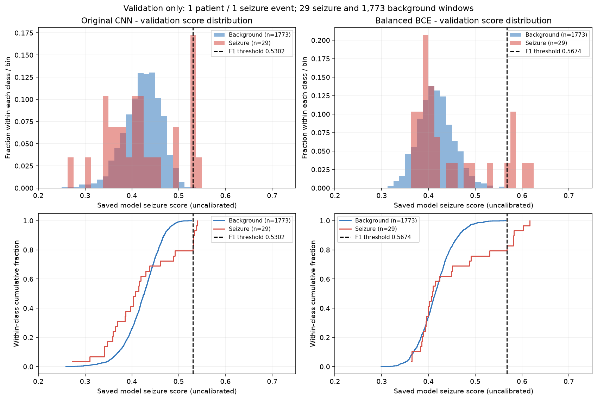
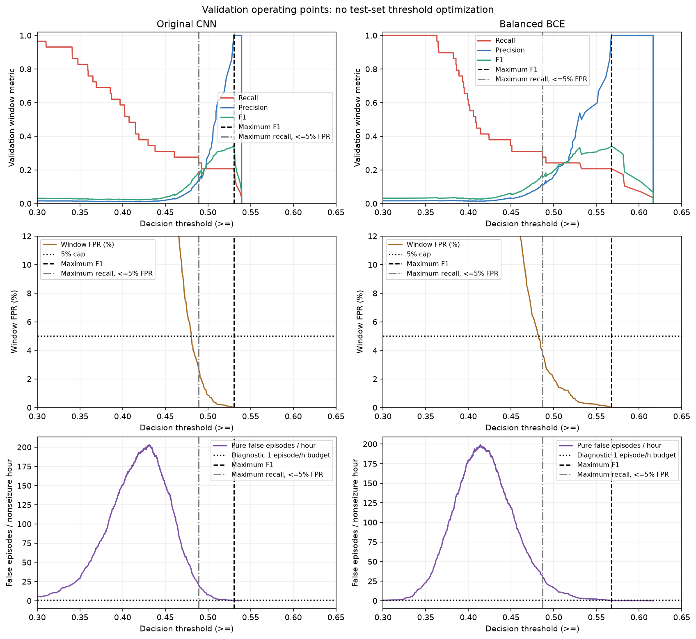
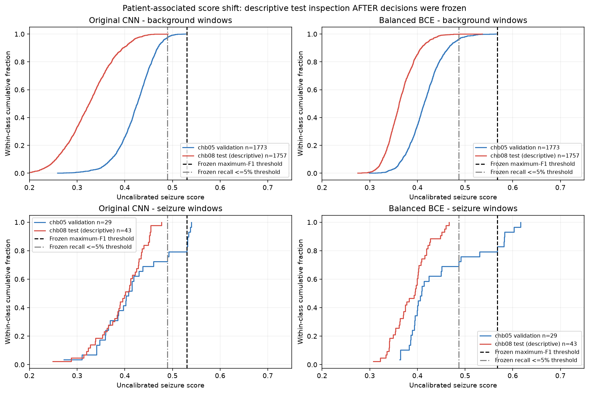
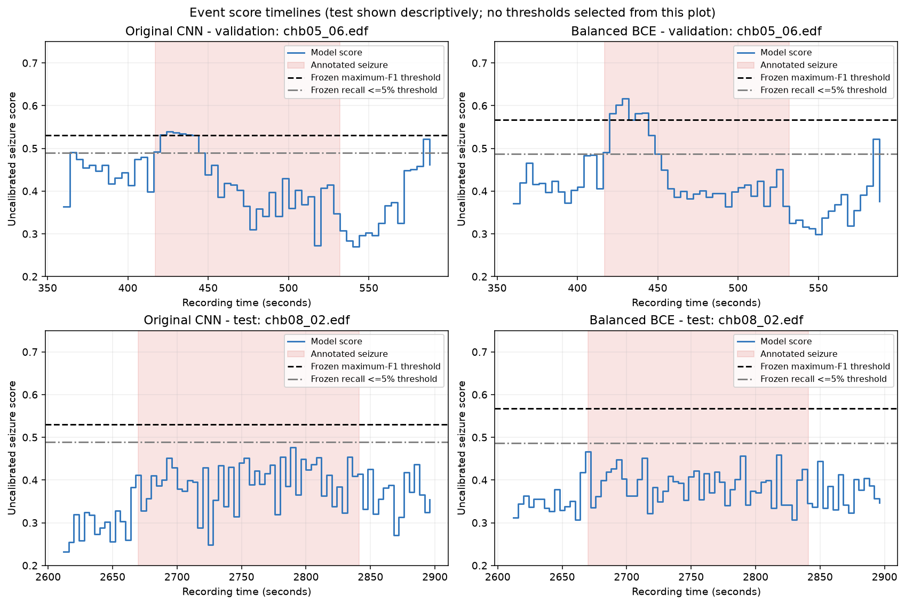
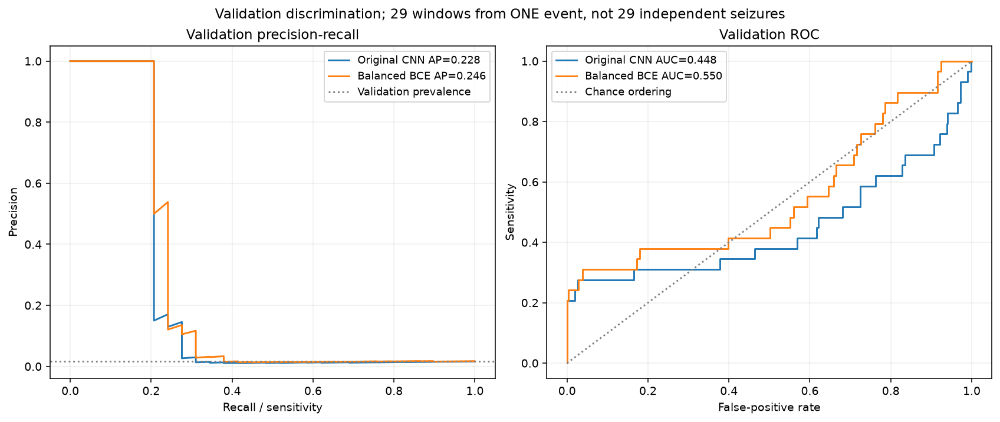

# Saved-score CNN diagnosis — 14 October 2026

The original and Balanced BCE CNNs both fail to detect the chb08 seizure at their saved operating points. Validation-only alternatives also detect **0/43 test seizure windows and 0/1 test events**. Lower diagnostic thresholds introduce false positives rather than recover detection. Keep the existing frontend, original checkpoint and default threshold unchanged.

## Scope and evaluation status

No model was trained, no new inference or downloads were performed, and neither checkpoint nor any `demo/*.py` / Streamlit configuration file was modified. This audit uses actual saved scores, with round-trip float parsing and the exact `score >= threshold` rule. Hashes protect inputs and frontend files.

**There is no untouched final test set available in this subset.** chb08 was evaluated during both previous experiments and the original threshold audit. It remains excluded from model training and validation threshold selection, but this report is an exploratory reanalysis of a previously examined test patient. No claim of fresh confirmatory evaluation is justified. Scores were read only after validation decisions were frozen; no threshold was selected or revised using test performance.

## Validation distribution and candidate thresholds

Validation: chb05_01 and chb05_06, 1,802 complete four-second windows (1,773 background; 29 seizure windows from one event). Distributions below are pooled by class; per-recording quantiles are in `validation_distributions.csv`. Scores are softmax outputs, not established calibrated clinical risks.

| Model | Class | n | Mean | Median | 10–90% | Range |
|---|---|---|---|---|---|---|
| Original CNN | Background | 1773 | 0.4228 | 0.4265 | 0.3718–0.4692 | 0.2591–0.5278 |
| Original CNN | Seizure | 29 | 0.4210 | 0.4075 | 0.3409–0.5322 | 0.2723–0.5394 |
| Balanced BCE | Background | 1773 | 0.4160 | 0.4144 | 0.3686–0.4653 | 0.2989–0.5655 |
| Balanced BCE | Seizure | 29 | 0.4490 | 0.4086 | 0.3788–0.5822 | 0.3631–0.6164 |



The seizure median is below the background median for both models. Only the high-score tail of this one seizure is separable at low false-positive rates; lowering a global threshold rapidly admits background windows.

Selection rules, fixed before accessing test scores:

- Reference: each checkpoint's saved threshold. Original used legacy-grid validation F1, not the new 5% policy.
- Primary comparison: maximum validation F1 with window FPR ≤5%; ties fewer FP, then higher threshold.
- Guarded diagnostic: maximum validation recall with window FPR ≤1% AND ≤1 purely false episode/nonseizure hour; ties higher F1, fewer FP, higher threshold. This is a declared engineering budget, not a clinical standard.
- Cost diagnostics: maximum validation recall under 0.5% or 5% window FPR, same ties. These are exploratory alternatives, not deployment recommendations.

| Model / validation policy | Threshold | Precision | Recall = sensitivity | F1 | Specificity | FP windows | False episodes/h |
|---|---|---|---|---|---|---|---|
| Original CNN / saved | 0.500000000 | 28.57% | 20.69% | 0.2400 | 99.15% | 15 | 7.61 |
| Original CNN / recall_guarded | 0.530214846 | 100.00% | 20.69% | 0.3429 | 100.00% | 0 | 0.00 |
| Original CNN / recall_cap_half_percent | 0.530214846 | 100.00% | 20.69% | 0.3429 | 100.00% | 0 | 0.00 |
| Original CNN / recall_cap_5percent | 0.489078879 | 14.55% | 27.59% | 0.1905 | 97.35% | 47 | 19.79 |
| Balanced BCE / saved | 0.567425787 | 100.00% | 20.69% | 0.3429 | 100.00% | 0 | 0.00 |
| Balanced BCE / recall_guarded | 0.567425787 | 100.00% | 20.69% | 0.3429 | 100.00% | 0 | 0.00 |
| Balanced BCE / recall_cap_half_percent | 0.530476272 | 53.85% | 24.14% | 0.3333 | 99.66% | 6 | 3.05 |
| Balanced BCE / recall_cap_5percent | 0.486873358 | 11.69% | 31.03% | 0.1698 | 96.16% | 68 | 31.47 |

All distinct reachable >= decisions, including the no-alert decision, were swept on validation only. The full CSVs contain precision, recall, sensitivity, F1, specificity, FP/FN/TP/TN, FPR and alarm burden for every threshold. `validation_candidate_thresholds.csv` additionally summarizes F1 and recall objectives at caps 0%, 0.1%, 0.5%, 1%, 2%, 5%, 10%, and unconstrained. No test threshold sweep was run.



## Why the 5% cap yields missed held-out seizures

The cap itself is **not binding** at maximum F1: for BOTH models, unconstrained maximum validation F1 selects the same threshold as the 5% cap, with 6 TP, 23 FN and 0 FP (recall 20.69%, F1 0.342857). Removing the cap while retaining the F1 objective does not fix this. F1 favors a small high-scoring seizure tail with perfect precision over extra seizure windows buried in background. This audit's maximum-F1 thresholds are 0.530214846 for original and 0.567425787 for Balanced BCE; the saved checkpoints and dashboard threshold remain unchanged.

Using the cap to maximize recall instead gives 8/29 TP with 47 FP for original, or 9/29 TP with 68 FP for Balanced BCE. This only increases validation recall to 27.59% / 31.03%, while causing 19.79 / 31.47 purely false episodes/hour and precision 14.55% / 11.69%. These rates are poor for a monitoring demonstration that treats each episode as an alert.

Balanced BCE's milder 0.530476272 threshold gives 7/29 TP, 6 FP, precision 53.85%, F1 0.333333, and 3.05 false episodes/hour. It gains just one validation seizure window versus maximum F1. Whether three nuisance alerts/hour is acceptable would need an explicit use-case budget; it is not treated as justified for automatic deployment. The guarded ≤1 episode/hour rule recovers no additional validation seizure windows for either model.

## Patient-associated shifts and input checks

| Model | Class | chb05 median | chb08 median | Median shift | chb05 / chb08 p90 |
|---|---|---|---|---|---|
| Original CNN | Background | 0.4265 | 0.3256 | -0.1009 | 0.4692 / 0.3962 |
| Original CNN | Seizure | 0.4075 | 0.4009 | -0.0066 | 0.5322 / 0.4513 |
| Balanced BCE | Background | 0.4144 | 0.3617 | -0.0527 | 0.4653 / 0.4083 |
| Balanced BCE | Seizure | 0.4086 | 0.3950 | -0.0136 | 0.5822 / 0.4441 |



chb08's seizure-score maxima are 0.476711154 (original) and 0.466002792 (Balanced BCE), below even the 5%-cap recall thresholds (0.489078879 / 0.486873358). This explains zero TP at every frozen candidate. A downward background shift also reduces FP on test compared with validation. These are **patient-associated descriptive shifts**, confounded by event morphology and recording conditions; one patient/event per split cannot isolate a patient effect statistically. No chb01/chb03 training-score predictions were saved, so a full training-patient score distribution cannot be reported without additional inference, which this audit does not perform.

Verified against actual local files:

- Train patients chb01/chb03 (six EDFs), validation chb05 (two), test chb08 (two); no shared patient group, repeated EDF fingerprint or recording across splits. Existing chb01/chb21 identity alias is preserved; PhysioNet identifies them as the same subject. [Dataset documentation](https://physionet.org/content/chbmit/1.0.0/chb21/)
- All ten EDF and matching annotation-summary hashes agree with BOTH saved checkpoint provenance records; both models used identical records/splits.
- Eight ordered channels: FP1-F7, F7-T7, T7-P7, P7-O1, FP2-F4, F4-C4, C4-P4, P4-O2; 256 Hz, shape (8, 1024), four-second non-overlapping windows. No silent channel padding or resampling.
- Shared 1–40 Hz, order-4 zero-phase SOS filtering with up to two seconds of surrounding context, crop, then per-channel per-window z-score. Live EDF examples from every recording gave identical lazy-training and shared-inference preprocessing arrays, finite values, near-zero mean and unit standard deviation. `preprocessing_examples.csv` records 16 examples.
- Every saved training/validation/test window index matches regenerated local annotation/timing labels: seizure-union overlap ≥50%, complete windows only, trailing partial windows discarded (two seconds in chb05_01). Context remains within a single recording/patient, so it does not cross a data split. This offline filter uses future samples and is not a causal early-prediction evaluation.

The verified consistency rules out the checked timing/channel/normalization mismatches; it does not prove feature adequacy. Z-score removes absolute amplitude information, eight channels omit other available spatial information, and the existing architecture includes BatchNorm and global average pooling. Their contribution to poor cross-patient transfer is a hypothesis, not an established causal finding from these scores.

## False alarms and event interpretation

An alarm episode is a maximal run of contiguous predicted-positive windows within one EDF. There is no smoothing, gap merging, refractory period or merging between files. A **purely false episode** has zero overlap with any ground-truth seizure. A seizure-touching episode is counted as event detection; its background duration is still reported so a long alarm is not made to look harmless. This retrospective event rule uses any positive temporal overlap, whereas window metrics use the existing ≥50% labeling rule.

Validation exposure is 7,208 covered seconds minus 115 annotated seizure seconds = **1.970278 nonseizure hours**. Test exposure is 7,200 minus 171 = **1.952500 nonseizure hours**. Background-label-window exposure differs slightly at seizure boundaries; the CSVs keep that denominator separate for FP-window/hour. A 5% window FPR corresponds to about 45 FP four-second windows per background hour, NOT necessarily 45 alarm episodes. Event rates depend on adjacency and are computed directly here. Also report background-alert seconds/hour, rather than assume episode count captures alarm duration.

At maximum-F1 thresholds validation detects 1/1 event but only 6/29 positive windows. That 100% event fraction is a single observed event, not robust event sensitivity. On test every frozen policy detects 0/1 event. Zero observed false alarms over roughly two hours does not establish a low population false-alarm rate; correlated windows and one event prevent credible narrow confidence bounds.

## Frozen held-out evaluation — exploratory, not a fresh final test

| Model / frozen policy | Threshold | Precision | Recall = sensitivity | F1 | Specificity | FP | False episodes/h | Confusion [[TN,FP],[FN,TP]] |
|---|---|---|---|---|---|---|---|---|
| Original CNN / saved | 0.500000000 | 0.00% | 0.00% | 0.0000 | 100.00% | 0 | 0.000 | [[1757, 0], [43, 0]] |
| Original CNN / recall_guarded | 0.530214846 | 0.00% | 0.00% | 0.0000 | 100.00% | 0 | 0.000 | [[1757, 0], [43, 0]] |
| Original CNN / recall_cap_half_percent | 0.530214846 | 0.00% | 0.00% | 0.0000 | 100.00% | 0 | 0.000 | [[1757, 0], [43, 0]] |
| Original CNN / recall_cap_5percent | 0.489078879 | 0.00% | 0.00% | 0.0000 | 99.94% | 1 | 0.512 | [[1756, 1], [43, 0]] |
| Balanced BCE / saved | 0.567425787 | 0.00% | 0.00% | 0.0000 | 100.00% | 0 | 0.000 | [[1757, 0], [43, 0]] |
| Balanced BCE / recall_guarded | 0.567425787 | 0.00% | 0.00% | 0.0000 | 100.00% | 0 | 0.000 | [[1757, 0], [43, 0]] |
| Balanced BCE / recall_cap_half_percent | 0.530476272 | 0.00% | 0.00% | 0.0000 | 99.94% | 1 | 0.512 | [[1756, 1], [43, 0]] |
| Balanced BCE / recall_cap_5percent | 0.486873358 | 0.00% | 0.00% | 0.0000 | 99.89% | 2 | 1.024 | [[1755, 2], [43, 0]] |

Zero-positive-prediction precision is reported as zero (the implementation's zero_division=0 convention), not evidence of zero-error detection. Distinct thresholds were each evaluated once in this audit (three per model); duplicate policy thresholds reuse those computed results. The test phase refuses to run a second time in the same report directory. The exact full precision, sensitivity, specificity, counts, rates and AUC/AP are in `held_out_results.json` and `frozen_policies_test.csv`. No threshold was revised after viewing these results.



## Discrimination, imbalance and training evidence



The models were selected at epoch 1. Both saved histories show falling training loss but worsening class-balanced validation cross-entropy in later epochs, consistent with overfitting to the small subset. Loss values between original weighted CE and candidate balanced BCE are different objectives and should not be directly ranked. Training retained 47 seizure windows and 2,400 background windows; original natural sampling yields about 73.3% all-background batches at batch size 16. Balanced BCE eliminates those batches but repeats only 47 unique seizure windows across 1,440 positive draws over three epochs. Repeated draws are not new seizure diversity.

Validation was already used to choose epochs and thresholds, and this audit explores additional policies on that same one event. Validation performance is therefore selection-dependent, not an independent estimate of generalization. No window-wise significance tests or narrow confidence intervals are claimed.

Test AUC/AP, descriptive only: original 0.825482 / 0.158814; Balanced BCE 0.667893 / 0.064731. Rank separation on the one test event is better for original despite low absolute scores; neither gives a defensible validation-derived alert threshold with useful test recall. Balanced sampling alone did not resolve transfer. Score calibration was not fitted or established. Calibration requires independent calibration/evaluation data; a monotone remapping cannot rescue poor rank discrimination. [scikit-learn calibration documentation](https://scikit-learn.org/stable/modules/calibration.html)

## Recommendations

1. Keep the existing dashboard model and threshold unchanged; retain the prominent zero-held-out-recall warning and distinct annotated versus CNN alerts. Neither threshold relaxation nor Balanced BCE promotion is supported by these measurements.
2. Define an alert budget in episodes/hour **and** background-alert duration, then preregister the selection objective and temporal postprocessing. A 5% window FPR cap alone is too permissive for monitoring and does not force better recall. Do not use chb08 to tune this budget, thresholds, model epochs, or smoothing.
3. Before another model experiment, review per-channel filtered traces and artifacts around the annotated events, preserving absolute amplitude descriptors alongside z-scores; compare channel coverage and acquisition differences. The normalization and architecture hypotheses need controlled validation tests, not an asserted fix.
4. Meaningful threshold transfer and calibration need multiple independent validation patients and events, and a NEW untouched test cohort. The present 47 unique training-positive windows from four events/two patients are insufficient to substantiate generalization. Additional patient/event diversity is genuinely needed for a credible research claim, though it does not guarantee improvement. No data was downloaded here.
5. If future experiments are authorized, vary one factor at a time (amplitude-preserving features, normalization/BatchNorm alternative, channel coverage or temporal aggregation) with patient-grouped validation and a fixed resource budget. Score calibration should follow adequate discrimination and must use separate/grouped calibration data. Do not automatically schedule more training.

## Reproduction and files

Run from the project root using a NEW output directory (the audit never overwrites reports):

```bat
.venv\Scripts\python.exe -m src.component.presentation.score_audit --phase validation --output reports\threshold_diagnosis_run2
.venv\Scripts\python.exe -m src.component.presentation.score_audit --phase freeze-alternatives --output reports\threshold_diagnosis_run2
.venv\Scripts\python.exe -m src.component.presentation.score_audit --phase test --output reports\threshold_diagnosis_run2
```

These commands are for audit reproducibility, not a request to rerun test evaluation or reopen threshold tuning. They do not train or run neural-network inference. `render_report.py` renders this directory's frozen outputs and refuses existing plots/tables.

Evidence: `validation_freeze.json`, `exploratory_freeze.json`, `held_out_results.json`, `data_verification.json`, all-threshold CSVs, candidate table, distribution and shift CSVs, preprocessing examples and five plots. Source: `src/component/presentation/score_audit.py`; regression tests: `src/tests/test_presentation_score_audit.py`. Test and preservation verification are recorded separately in `verification.json`.

Verification completed: **77 tests passed, 1 skipped, 0 failed** (42.84 seconds). The skip is the existing optional safetensors test; the upstream torch.jit deprecation warning is nonfatal. Tests use temporary synthetic fixtures and do not retrain project checkpoints. Six new audit regressions cover alarm exposure/episodes/boundaries, overlapping annotation union, file seams and missing windows, validation-policy constraints, exact float parsing, score/index alignment and refusal to repeat held-out evaluation. Independently checked all 1,802 original and 1,803 Balanced BCE validation operating points against direct >= decisions. All saved score labels/times/patients match verified indexes, all ten EDF/summary hashes still match, and both checkpoint plus all frontend Python/Streamlit configuration hashes are unchanged. All five plots were visually inspected.
